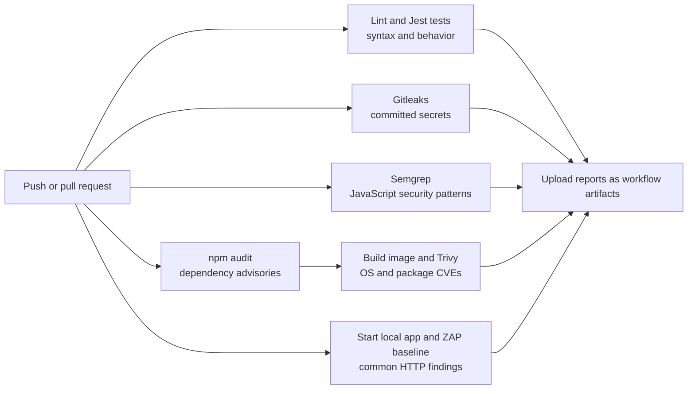

# DevSecOps pipeline

The workflow runs on every push and pull request. The checks are independent jobs, so a failing check does not prevent other scanners from running or uploading their reports.

The Jest/supertest tests check login, cross-user note reads, and a SQL injection-shaped search value. `vulnerable` intentionally fails these security expectations. Semgrep uses free community Node.js and OWASP Top 10 rules. `npm audit` and Trivy fail only for high or critical findings to keep low-severity advisory noise from blocking this beginner example. Gitleaks and ZAP retain their normal action behavior. Scanner outputs are uploaded under their job's artifact name, including when an earlier step in that job fails.

To run it, push the branch to GitHub or open a pull request. In the repository's **Actions** tab, open the **SecureNotes DevSecOps** run and download artifacts from each completed job. A scan can fail because a third-party action, advisory database, or service is unavailable; inspect that job's log before treating it as an app finding.
