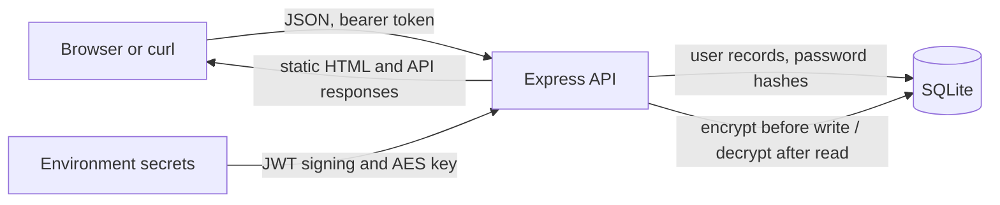

# Threat model

## Scope and data flow

The browser or a curl client sends JSON over local HTTP to the Express API. Registration and login check credentials against SQLite. On `main`, login returns a signed bearer token; protected routes verify it, validate inputs, and use the token's user ID to scope note queries. Note content is encrypted before it is written to SQLite and decrypted when returned. The static HTML page displays note text using `textContent`.

The local sample does not provide HTTPS. A network observer could read requests if the app were exposed beyond the local machine; see [data protection](data-protection.md) for production requirements.

## STRIDE

| Threat | Example in this app | Mitigation on `main` |
|---|---|---|
| Spoofing | An attacker pretends to be a user | bcrypt login and signed, expiring JWTs |
| Tampering | A user changes an ID to alter another user's note | Owner-scoped queries and authenticated-encryption tags |
| Repudiation | A user denies creating or deleting a note | This teaching app has no audit log; production should add access-controlled, content-free audit events |
| Information disclosure | SQL injection reveals other notes or the database file is copied | Parameterized SQL, owner checks, encrypted content, secret separation |
| Denial of service | Repeated password guesses or oversized input consume resources | Login rate limit, JSON size cap, and input length validation |
| Elevation of privilege | A user reads or deletes another user's note | Check ownership for every note ID operation |

## OWASP Top 10 (2021) mapping

| Category | Applies? | Reason and relevant control |
|---|---|---|
| A01 Broken Access Control | Yes | Note IDs are direct object references; all note queries on `main` include the owner ID. |
| A02 Cryptographic Failures | Yes | Password storage and note confidentiality matter; bcrypt and AES-256-GCM are used. |
| A03 Injection | Yes | Search input and HTML output cross interpreters; SQL uses placeholders and the page uses `textContent`. |
| A04 Insecure Design | Yes | Authentication, ownership, and rate limits are required design controls. |
| A05 Security Misconfiguration | Yes | Headers, secrets, and deployment exposure matter; Helmet is enabled and secrets are environment configuration. |
| A06 Vulnerable and Outdated Components | Yes | Dependencies can contain known flaws; CI runs `npm audit` and Trivy. |
| A07 Identification and Authentication Failures | Yes | Login uses bcrypt, JWT expiry, and rate limiting. |
| A08 Software and Data Integrity Failures | Yes | Dependency and image integrity are in scope; CI scans dependencies and container packages. |
| A09 Security Logging and Monitoring Failures | Yes | The sample deliberately avoids logging sensitive values but has no security event monitoring; production needs safe event logs and alerts. |
| A10 Server-Side Request Forgery | No current feature | The API makes no user-directed outbound network requests. Reassess if URL fetching or webhooks are added. |
